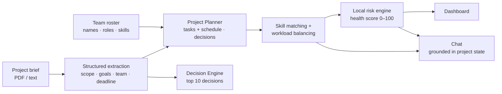

<h1 align="center">Risk Radar</h1>

<p align="center">
  <b>AI project risk and decision engine</b><br>
  Turns a project brief and team roster into a skill-matched plan, a project health score,
  and a ranked agenda of the decisions a manager needs to make before work begins.
</p>

<p align="center">
  
  
  
  
  
</p>

---

## Overview

Project management tools are good at tracking tasks and reporting problems once they appear. Managers also need to spot risks before execution starts, assign work according to each person's skills and capacity, and decide which open questions need attention first.

Risk Radar brings planning, risk scoring, workload visibility and decision support into one workflow. Built for the **NYU SPS × Asana Challenge 2026** by team **Task Force One**.

> Risk Radar supports planning and risk awareness. Its recommendations are meant to inform managers' decisions, not replace their judgement.

## The four modules

| Module | What it does |
|---|---|
| **Project Planner** | Takes scope, goals, team and deadline (or extracts them from an uploaded brief) and generates a 12–15-task plan with phases, skill-matched assignees, a schedule, and the ten most critical pre-project decisions. |
| **Risk Dashboard** | Calculates a 0–100 project health score and shows the risk drivers behind it, plus per-person workload and overload warnings. Runs entirely in Python with no API calls. |
| **Decision Engine** | Analyses an uploaded brief and surfaces the ten highest-impact decisions, each with options, a recommended course of action and its rationale. Results are cached after the first run. |
| **Context-aware Chat** | Answers questions about risks, capacity, estimated hours, timelines and individual tasks, with the current project state injected so answers are grounded in the actual plan. |



## How the health score works

The risk engine checks every open task and deducts points for each risk it finds:

| Risk | Rule | Penalty |
|---|---|---|
| Overdue | Past its due date (critical after 5 days) | −15 |
| Unassigned | No owner | −10 |
| No deadline on complex task | High complexity with no due date | −10 |
| Stalled | No activity for 3+ days | −5 |

Scores of 75 and above are labelled healthy. Anyone holding three or more open tasks gets an overload warning. Each risk card includes a suggested next step, such as escalating, reassigning or setting a due date.

## Engineering decisions

- **Deterministic risk logic.** Health scoring and risk classification run in pure Python, so the dashboard works without an API key and gives the same answer every time.
- **Skill-aware assignment.** A keyword skill map covers backend, frontend, design, QA, machine learning, DevOps and project management. The model proposes assignees, then a local pass reassigns any task to the best-fit, least-loaded member, aiming to keep anyone's share at about 40% or less.
- **Token-conscious orchestration.** Brief compression, content-hash response caching, chat history trimming, and a live token meter that shows the cost of each action.
- **Two-call planning.** Planning is split into *tasks and schedule* and then *decisions*, keeping each response within the model's output limit to avoid truncation.
- **Four-stage JSON repair.** Strips markdown fences, extracts the JSON object or array, and closes truncated brackets so malformed model output rarely breaks the interface.
- **Structured extraction, not RAG.** Uploaded documents are parsed once into a structured schema; there is no vector store, chunking or retrieval step.

## Tech stack

**Python** · **Streamlit** · **Anthropic Claude Haiku 4.5** · **pypdf** · tasks use Asana's task format (an Asana REST API fetcher is included in the code)

## Getting started

**Requirements:** Python 3.10+. An Anthropic API key is needed for the Planner, Decision Engine and Chat; the Dashboard works without one.

```bash
git clone https://github.com/aishwaryapurohit15/risk-radar.git
cd risk-radar
pip install -r requirements.txt
streamlit run app.py
```

Then:

1. Paste your Anthropic API key in the sidebar.
2. Click **Load Data** to explore with demo tasks, or open **Project Planner** to build a plan from scratch.

## Project structure

```
risk-radar/
├── app.py            # Streamlit app: risk engine, planner, decision engine, chat
├── requirements.txt
├── LICENSE
└── README.md
```

## Team

Built by **Task Force One** for the NYU SPS × Asana Challenge 2026:

- [@aishwaryapurohit15](https://github.com/aishwaryapurohit15)
- [Harsh Motiramani (@Harshmm2003)](https://github.com/Harshmm2003)

## License

MIT. See [LICENSE](LICENSE).
